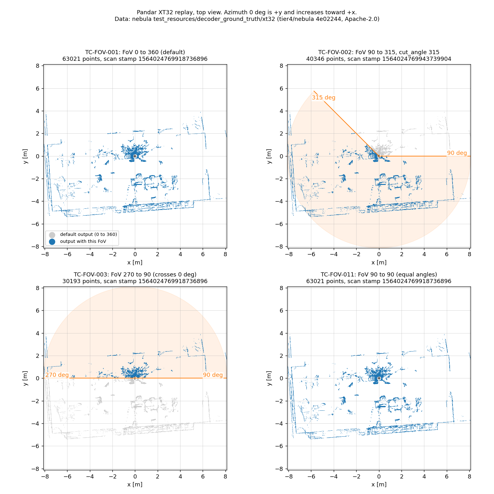

# LiDAR Driver Test Design: Hesai Pandar XT32 in tier4/nebula

[](https://github.com/jaewon-orbit/lidar-driver-test-design/actions/workflows/schema-check.yml)

A QA side project on documentation analysis and test design. It looks at the Hesai Pandar XT32 parameters in [tier4/nebula](https://github.com/tier4/nebula), pinned at commit [`4e02244`](https://github.com/tier4/nebula/tree/4e02244695879e823f570f13449d95cb642cd35a).
The same parameters are described in five places. They are cross-checked, every gap is recorded with evidence and an explicit assumption, and the resulting test cases are run as far as possible without a physical sensor.

## Reported upstream: [tier4/nebula#564](https://github.com/tier4/nebula/issues/564)

**`ptp_transport_type` parameter still reads UDP after auto-correction to L2**

| | |
|---|---|
| What | With `ptp_profile: 802.1as` and `ptp_transport_type: UDP`, the driver logs a warning and switches to the L2 transport (Ethernet layer 2) internally. The parameter is read-only, so it still reads `UDP`. Anyone who reads the parameter sees a different value from the one in use |
| How it was found | Source comparison (GAP-007): the docs call it a restriction, the code auto-corrects it. Then run in the driver without a sensor (TC-RUN-002) |
| How it was confirmed | Same result in 3 of 3 runs. Control: the same `ros2 param set` command does change a read-write parameter, so the refusal is specific to this parameter |
| Report | Facts, exact commit, reproduction steps, expected and actual output, code permalink, and what was not tested (`automotive` profile) |
| Status | Open, reported 2026-11-23 |

Details: [GAP-007](docs/02_gap_analysis.md), [L2 evidence](docs/evidence/l2-run-2026-11-22.md)

## Results at a glance

| Item | Result |
|---|---|
| Parameters inventoried | 32 |
| Gaps (GAP) | 15, each with evidence, assumption, impact and a question for the developers |
| Requirements | 21, each tied to a file and line |
| Test cases | 77 (L1 54, L2 11, L3 7, L4 5) |
| L1 schema checks | Automated in CI: 45 passed, 17 expected failures for known gaps |
| L2 driver runs (no sensor) | 11 cases, each run 3 times with identical results |
| L3 replay of recorded data | Default config reproduces nebula's reference point cloud exactly (63021 points). 4 FoV cases run |
| Traceability | Requirements: Full 19, Partial 2. Gaps: Full 13, Partial 1, None 1 |
| Upstream report | [tier4/nebula#564](https://github.com/tier4/nebula/issues/564) |

## Key findings

| # | Finding | Evidence |
|---|---|---|
| 1 | **GAP-007**: the PTP transport is auto-corrected to L2, but the parameter still reads `UDP`. Reported upstream, see above | [#564](https://github.com/tier4/nebula/issues/564), TC-RUN-002 |
| 2 | **GAP-008**: `data_port: 70000` is accepted and silently becomes 4464 (`uint16_t`), while the parameter still reads 70000 | [L2 run](docs/evidence/l2-run-2026-11-22.md), TC-RUN-003 |
| 3 | **GAP-002**: `rotation_speed: 900` is accepted by the schema and by the driver, but the vendor manual lists only 300, 600 and 1200 RPM | [Vendor manual check](docs/evidence/vendor-manual-2026-11-23.md), TC-RUN-001 |
| 4 | **GAP-001, GAP-005**: some schema rules have no effect with standard JSON Schema validators. Keywords next to `$ref` are ignored (`rotation_speed: 123` passes), and a pattern with an empty alternative accepts `not-an-ip` as a multicast address | [Probe](docs/evidence/probe-2026-11-22.md), [GAP analysis](docs/02_gap_analysis.md) |
| 5 | **GAP-013**: equal start and end FoV angles produce the full 360° scan, identical to FoV 0 to 360. The user docs do not state this rule | [L3 replay](docs/evidence/l3-replay-2026-11-23.md), TC-FOV-011 |
| 6 | **GAP-006**: the first analysis was wrong and was corrected. The driver does check `cut_angle` against the FoV at startup; only the schema lacks the rule | [GAP analysis](docs/02_gap_analysis.md), TC-FOV-010 |



*FoV settings applied to the replayed XT32 recording (L3). Data: nebula test data `decoder_ground_truth/xt32` at commit 4e02244, Apache-2.0.*

## Sources compared

| # | Source | What it is |
|---|---|---|
| A | Parameter docs | Hand-written parts of `docs/parameters/vendors/hesai/common.md` |
| B | JSON schema | `PandarXT32.schema.json` and its `$ref` targets |
| C | Default YAML | `PandarXT32.param.yaml` |
| D | Code | `HesaiSensorConfiguration`, its base structs, and the ROS parameter descriptors in `hesai_ros_wrapper.cpp` |
| E | Vendor manual | PandarXT User Manual X01-en-260710 (referenced by version and hash, not redistributed) |

## Test levels

These levels are this project's own scale for what a test needs. They are unrelated to the PTP "L2" transport in finding 1.

| Level | Needs | Status |
|---|---|---|
| L1 | Files only (schema validation) | 54 cases, automated with pytest, run in CI on every push |
| L2 | Driver node, no sensor (`launch_hw:=false`) | 11 cases run in a ROS 2 Jazzy container |
| L3 | Recorded sensor data | 4 FoV cases run on nebula's 0.3 s XT32 recording. 3 cases not run, with reasons |
| L4 | Real sensor | 5 cases designed, not run |

## Method

- **Candidates before gaps.** Suspicions were listed as candidates (C-01 to C-17) and promoted to GAP entries only after verification. Several changed on the way, and one turned out to be a tooling issue, not a nebula defect.
- **Control first.** Every series starts with a case that must pass. The first schema probe counted tool errors as rejections; the control case exposed it.
- **Facts and assumptions kept apart.** Expected results based on an assumption are marked `(assumption)`, and each GAP states its assumption and whether a run confirmed or rejected it.
- **Known gaps as strict xfail.** If nebula fixes one, the test starts passing and CI turns red, which signals that the docs here need updating. Two consistency tests keep the test case table and the code in sync.
- **Repeatable runs.** Each L2 and L3 case was run 3 times and compared after removing timestamps.
- **Environment issues separated.** Message loss in Docker with the default Fast DDS transport was traced to the test environment and fixed with a shared memory profile, not reported as driver behavior.
- **Generated traceability.** `docs/05_traceability.csv` is built by a script and checked in CI, so it cannot go stale.

## Repository layout

```
docs/
  00_scope.md                  target, pinned commit, sources, scope
  01_parameter_inventory.csv   32 parameters across sources A to E
  02_gap_analysis.md           15 gaps with evidence, assumptions, questions
  03_test_design.md            requirements, techniques, coverage rules
  04_test_cases.csv            77 test cases with level and basis
  05_traceability.csv          generated requirement and gap coverage
  evidence/                    probe, L2, L3 and vendor manual results
  figures/                     images used above
scripts/
  probe_schema.py              candidate verification against the schema
  build_traceability.py        generates docs/05_traceability.csv
  l2_run_case.sh               runs one L2 case in the container
  l3/                          L3 replay and analysis tools
tests/
  test_param_schema.py         L1 checks
.github/workflows/
  schema-check.yml             CI
```

## How to run

L1 checks (Python 3.12):

```
python3.12 -m venv .venv
. .venv/bin/activate
pip install -r requirements.txt
git clone https://github.com/tier4/nebula.git nebula
git -C nebula checkout 4e02244695879e823f570f13449d95cb642cd35a
pytest -v
```

Regenerate the traceability matrix:

```
python scripts/build_traceability.py
```

L2 and L3 runs need a ROS 2 Jazzy environment with nebula built (`--packages-up-to nebula_hesai`). The setup and results are in `docs/evidence/`.

## Limitations

- No physical sensor. L4 cases (PTP state changes, sensor behavior at an unsupported RPM) are designed but not run.
- The recording is 0.3 s with an unsynchronized sensor clock and no packet gap, so timestamp and diagnostic transition cases could not run.
- Schema findings were made with check-jsonschema and jsonschema. nebula's own CI uses a different validator, which was not checked.
- GAP-007 was observed with `802.1as` only. The `automotive` profile goes through the same code but was not run.
- Pairwise cases are designed but not executed.

## Attribution

This project is not affiliated with TIER IV or Hesai. nebula is licensed under Apache-2.0. File paths and line numbers refer to commit 4e02244. Figures use nebula's test data. The Hesai manual is a Hesai document and is not included here.
