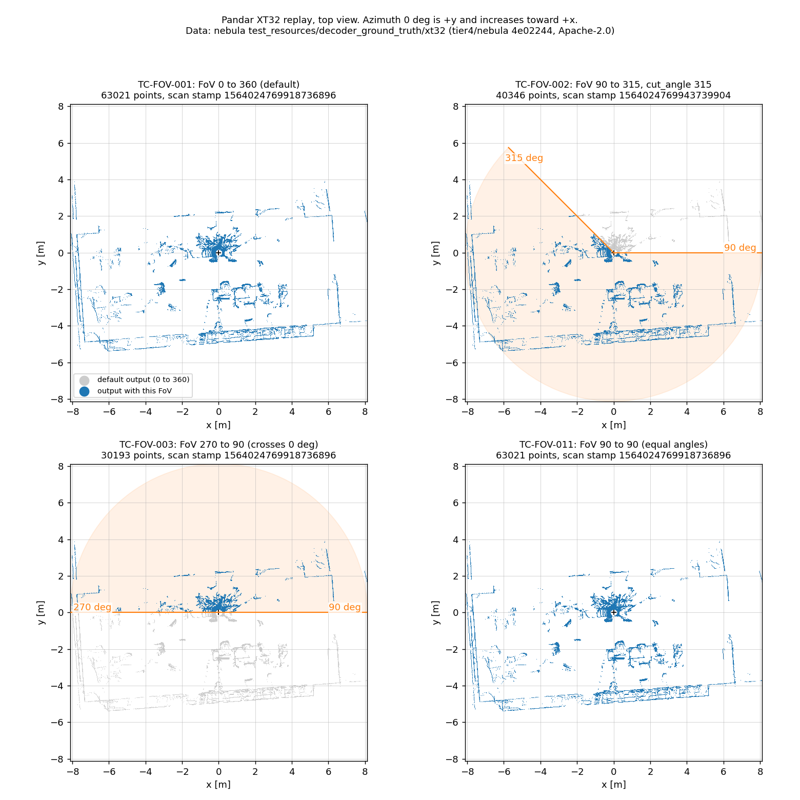
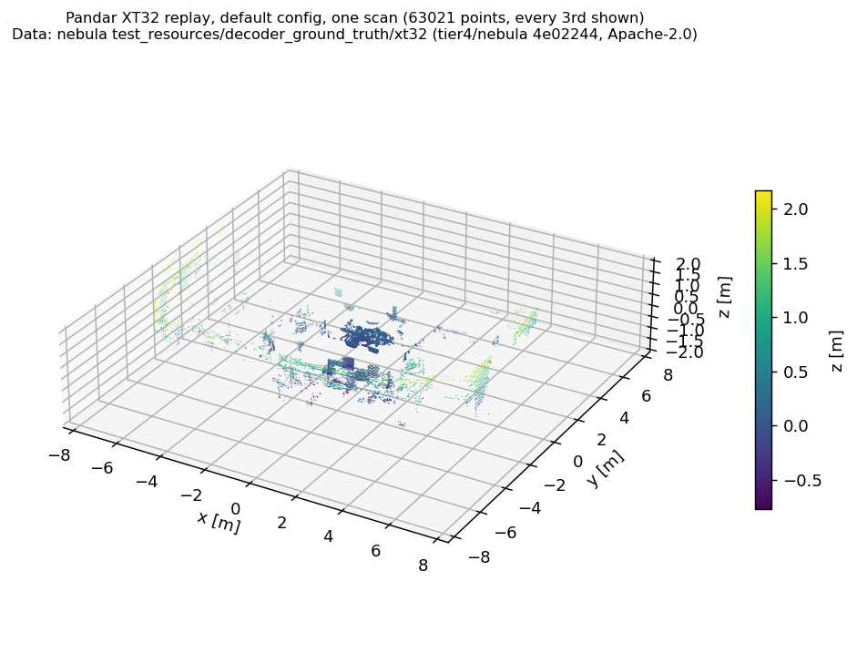

# L3 run result (replay of recorded XT32 data)

- nebula commit: 4e02244695879e823f570f13449d95cb642cd35a
- ROS 2 Jazzy, Docker image ros:jazzy (arm64), default RMW (Fast DDS; the Fast DDS profile below takes effect), on macOS (Apple Silicon)
- Recorded data: `src/nebula_hesai/nebula_hesai/test_resources/decoder_ground_truth/xt32/` in nebula (Apache-2.0)
  - rosbag `1673400677802009732/`: topic `/pandar_packets`, 4 messages of 500 packets each, 0.3 s
  - reference point cloud `1673400678101968885.pcd`: 63021 points (x, y, z). nebula's decoder test creates it with Dual, FoV 0 to 360, cut_angle 0, min_range 0.05, max_range 120 (`tests/hesai_ros_decoder_test_main.cpp` L35-L36), the same values as the default XT32 param file
- date: 2026-11-23

## Method

1. Start `hesai_ros_wrapper_node` as in the L2 run (default param file, `launch_hw:=false`, absolute calibration path) with the case's overrides
2. Start a subscriber on `/pandar_points` that stores each message as received
3. Wait until the node's publisher sees the subscriber, then `ros2 bag play --delay 3` the recording
4. Convert the stored messages to arrays and compute each point's azimuth as `atan2(x, y)` in degrees (the decoder sets `x = d * sin(azimuth)` and `y = d * cos(azimuth)`, `hesai_decoder.hpp` L233-L235). The `azimuth` field of every point agrees with this value (max difference 0.0000 deg)
5. Run every case 3 times. Compare the set of scans and the coordinates of each scan (MD5 of x, y, z in order) across runs

Tools: `scripts/l3/` (runner, subscriber, converter, analysis, run comparison, plot, Fast DDS profile).

### Test environment issue and fix

With the default Fast DDS transport, many messages were lost on the way to the node and to the subscriber, so the number of scans changed from run to run (0 to 4).

- Measured: a counter subscriber saw 0, 0, 0, 3 and 1 of the 4 packet messages in 5 runs at normal rate, and 1 or 2 of 4 at 0.1x rate
- Socket receive buffer in the container: `rmem_default=212992` bytes. One packet message is about 540 kB, one point cloud about 2 MB, and all endpoints are best effort (`hesai_ros_wrapper.cpp` L118-L119, `decoder_wrapper.cpp` L88-L90)
- With a Fast DDS profile that uses a shared memory transport with an 8 MB segment (`scripts/l3/fastdds_shm.xml`), 10 of 10 runs received all 4 packet messages and 4 point clouds
- Inference (not traced inside Fast DDS): large messages over UDP exceed the receive buffer and are dropped
- In one series the last case lost scans when `/dev/shm` was 80% full. Running `fastdds shm clean` before each run removed this
- This is an issue of the test environment, not of nebula. No nebula code or parameter was changed

### Control

| Check | Result |
|---|---|
| Default config reproduces nebula's reference cloud (TC-FOV-001) | 3 of 3 runs: one scan has 63021 points and equals the reference (max difference 0.000000 m) |
| Same scans in every run | 3 of 3 runs: 4 scans with the same stamps and the same coordinates |

## Results

| tc_id | input | expected (docs/04_test_cases.csv) | observed (3 of 3 runs identical) | verdict |
|---|---|---|---|---|
| TC-FOV-001 | FoV 0 to 360 | Points cover the full 0 to 360 deg range | 4 scans, 360 of 360 one-degree bins occupied, 0 points outside | Pass |
| TC-FOV-002 | FoV 90 to 315 (as written, cut_angle default 0) | (assumption) All point azimuths are in [90, 315] within 0.1 deg | Aborts at startup: "Cannot cut scan outside of the FoV." | Not executable as written |
| TC-FOV-002 | FoV 90 to 315, cut_angle=315 | same | 161493 points in 4 scans, azimuth 90.009 to 314.999 deg, 0 points outside, 225 of 225 bins occupied | Matches assumption |
| TC-FOV-003 | FoV 270 to 90 | Point azimuths are only in [270, 360) and [0, 90] | 120547 points in 4 scans, 0 points outside, 180 of 180 bins occupied | Pass |
| TC-FOV-010 | FoV 0 to 360, cut_angle=360 | (assumption) Rejected | Aborts at startup: "Cannot cut a 360deg FoV at 360deg. Cut at 0deg instead." | Matches assumption |
| TC-FOV-011 (replay) | FoV 90 to 90 | (L2 case, assumption) Rejected at launch | Starts. All 4 scans equal the scans of FoV 0 to 360 (same stamps, point counts and coordinates) | Differs from assumption |

Notes:
- TC-FOV-002 as designed leaves cut_angle at its default 0. The driver requires cut_angle inside the FoV (`hesai_decoder_settings.hpp` L46-L48), so the case was run with cut_angle=315, the end of the FoV, which the driver recommends for partial FoVs (`hesai_decoder_settings.hpp` L51-L52)
- The first scan of each run starts in the middle of a rotation, so it has fewer points
- TC-FOV-011 is an L2 case. The replay adds the output behavior to the L2 result

Grey: output with the default FoV 0 to 360. Blue: output with the FoV of the panel. Orange: configured FoV.

## L3 cases not run

The available recording does not meet the precondition of these cases.

| tc_id | precondition | finding |
|---|---|---|
| TC-CUT-001, TC-CUT-002 | PTP-synced recording with known sync_angle | The sensor time in the packets is 2019-07-25 while the recording was made on 2023-01-11, so the sensor clock was not synchronized with the recording host. A search of `pandar_xt32.hpp` found no PTP or sync status field in the packet. sync_angle is only sent to the sensor by the hardware interface (`hesai_hw_interface.cpp` L490-L502, L1121-L1131) and is not used by the decoder, so a replay cannot apply sync_angle=30 |
| TC-DIAG-002 | recording with a gap in packets | 4 messages of 500 packets. Largest gap between packets inside a message 0.49 ms, between messages at most 0.9 ms: no gap. The rate diagnostic measures time when each scan is published (`rate_bound_status.hpp` L106-L136), so a gap would have to be created by the replay timing, which is not the recorded condition |

## Limits of this run
- One recording of 0.3 s from one scene, Dual return mode only
- Coordinates are compared exactly. No tolerance is applied, so any change in the decoder output would show as a difference
